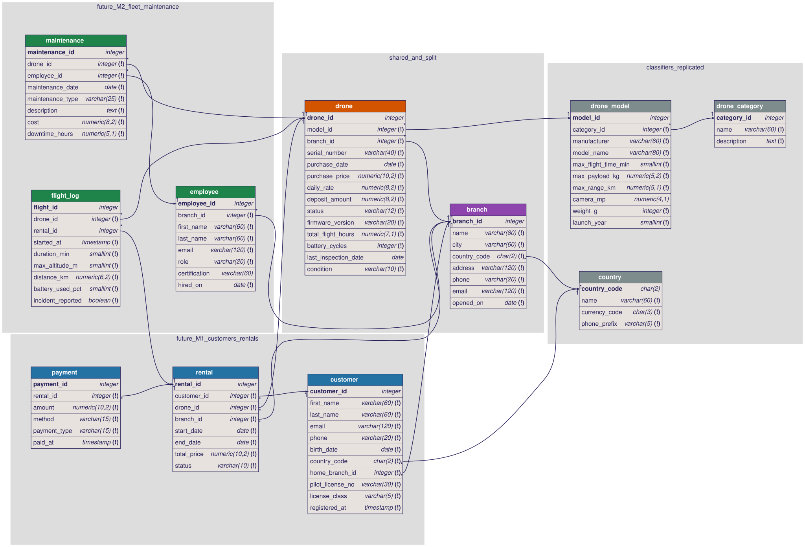
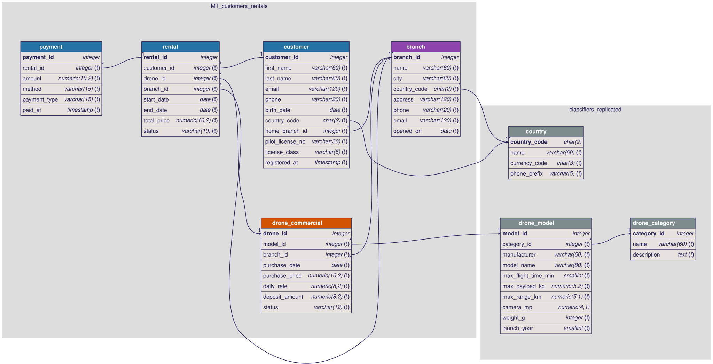
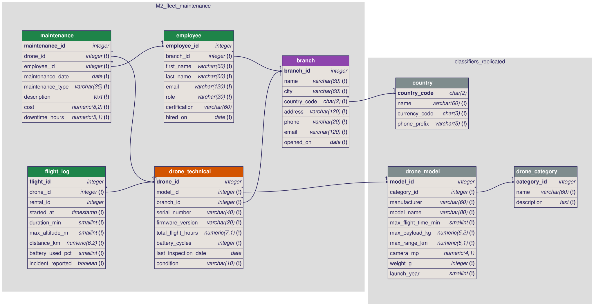
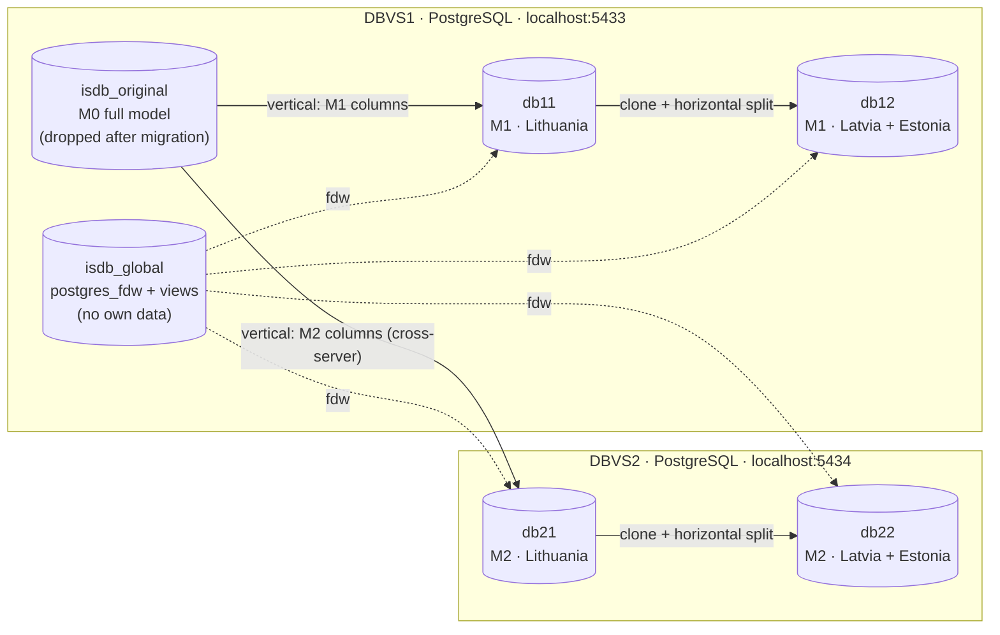

# ISDB Lab 1: SkyRent distributed database

**P175B129 Išskirstytos duomenų bazės, 1-asis laboratorinis darbas**

A PostgreSQL database for **SkyRent**, a drone rental network with branches in Lithuania, Latvia and Estonia. The database is:

1. modelled as one original schema (**M0**),
2. split **vertically** by function into **M1** (Customers & Rentals) and **M2** (Fleet & Maintenance), and
3. split **horizontally** by country, giving **LT** fragments and **LV + EE** fragments.

The four fragments run on **two independent PostgreSQL servers**.

> **Santrauka (LT).** Dalykinė sritis: dronų nuomos tinklas. Pradinis modelis M0 (11 lentelių, `drone` lentelėje 14 atributų) vertikaliai padalintas pagal funkcinę paskirtį: M1 yra klientų ir nuomos modulis, M2 yra parko ir techninės priežiūros modulis. `drone` lentelė padalinta į `drone_commercial` (M1) ir `drone_technical` (M2), abi su tuo pačiu raktu `drone_id`. Klasifikatoriai (`country`, `drone_category`, `drone_model`) perkelti pilna apimtimi į visus fragmentus. Horizontalus fragmentavimas atliktas pagal filialo šalį (`branch.country_code = 'LT'` arba LV/EE), tuo pačiu kriterijumi abiem vertikaliems fragmentams. DBVS1 turi DB11 ir DB12, DBVS2 turi DB21 ir DB22 (PostgreSQL 17). Vietoje MSOSA modeliai sudaryti su **DBML / dbdiagram.io**, o gynimui naudojamas **pgAdmin 4** (įskaitant jo ERD įrankį).

| | |
|---|---|
| DBMS | 2 × PostgreSQL 17 (Docker): **DBVS1** `localhost:5433`, **DBVS2** `localhost:5434` |
| Distributed access | `postgres_fdw` (foreign tables + reconstruction views in `isdb_global`) |
| Modelling tool (replaces MSOSA) | **DBML** → [dbdiagram.io](https://dbdiagram.io); SVGs rendered with `dbml-renderer`; pgAdmin **ERD Tool** for the live DBs |
| Admin / demo tool | **pgAdmin 4** at `http://localhost:5050`, both servers pre-registered |
| Defence walkthrough | **[docs/PGADMIN_GUIDE.md](docs/PGADMIN_GUIDE.md)** |

---

## Requirements checklist

| Requirement | How it is met |
|---|---|
| ≥ 8 tables | 11 tables in M0; each vertical fragment M1 and M2 has 8 tables |
| One table with ≥ 8 attributes | `drone` has **14** (also `customer` 11, `drone_model` 10) |
| ≥ 10 rows in every table | Every table has ≥ 10 rows **in every one of the 4 fragments** (see [row counts](#result)) |
| Vertical fragmentation through the widest table, logical split | `drone` (14 attr.) → `drone_commercial` (M1) + `drone_technical` (M2), key `drone_id` in both |
| Classifiers moved in full | `country`, `drone_category`, `drone_model` are replicated completely into all 4 DBs |
| Fragments linked | Same PK `drone_id` in both halves; `flight_log.rental_id` (M2) → `rental` (M1) cross-DBMS reference |
| DB11, DB21 from M1, M2; clones DB12, DB22 | `db12` is created with `CREATE DATABASE db12 TEMPLATE db11` (same for `db22`) |
| Horizontal fragmentation, same criterion for both vertical fragments | `branch.country_code = 'LT'` → DB11/DB21; `<> 'LT'` → DB12/DB22 |
| Only domain data fragmented horizontally | Classifiers are not fragmented, only `branch`, `customer`, `drone_*`, `rental`, `payment`, `employee`, `maintenance`, `flight_log` |
| Scenario | **Scenario 2**: full DB → vertical fragments via queries → clone → horizontal split → original dropped |

---

## Data models

The models are written in **DBML** (the language of [dbdiagram.io](https://dbdiagram.io)). To view or edit one interactively, paste a `.dbml` file into dbdiagram.io. The SVGs below were rendered from those same files.

Header colours: grey = classifier, purple = `branch` (fragmentation attribute), orange = the vertically split `drone`, blue = M1 tables, green = M2 tables.

### M0: original model (before fragmentation)
[`docs/model/m0_original.dbml`](docs/model/m0_original.dbml)



### M1: vertical fragment "Customers & Rentals" → DB11 / DB12 on DBVS1
[`docs/model/m1_customers_rentals.dbml`](docs/model/m1_customers_rentals.dbml)



### M2: vertical fragment "Fleet & Maintenance" → DB21 / DB22 on DBVS2
[`docs/model/m2_fleet_maintenance.dbml`](docs/model/m2_fleet_maintenance.dbml)



---

## Fragmentation design

### Vertical: split by function

| Module | Purpose | Tables |
|---|---|---|
| **M1** Customers & Rentals | who rents what, and money | `customer`, `rental`, `payment`, `drone_commercial` |
| **M2** Fleet & Maintenance | the physical fleet and its upkeep | `employee`, `maintenance`, `flight_log`, `drone_technical` |
| both (replicated) | needed to serve each fragment | `country`, `drone_category`, `drone_model` (classifiers), `branch` |

How the 14 columns of `drone` are divided:

| `drone` column | M1 `drone_commercial` | M2 `drone_technical` |
|---|:-:|:-:|
| `drone_id` (PK) | ✔ | ✔ |
| `model_id`, `branch_id` (FK, replicated) | ✔ | ✔ |
| `purchase_date`, `purchase_price`, `daily_rate`, `deposit_amount`, `status` | ✔ | |
| `serial_number`, `firmware_version`, `total_flight_hours`, `battery_cycles`, `last_inspection_date`, `condition` | | ✔ |

`model_id` and `branch_id` appear in both halves. That way each fragment can join to its local classifier and branch, and both halves can be fragmented horizontally by the same criterion without a cross-server lookup. The reconstruction is `drone = drone_commercial ⋈ drone_technical` on `drone_id`, which is lossless.

### Horizontal: split by branch country

* **Primary** horizontal fragmentation: `branch` with `country_code = 'LT'` (10 branches) versus `country_code IN ('LV','EE')` (10 branches).
* **Derived** fragmentation (semi-join through FKs):
  * `customer` via `home_branch_id`
  * `rental` via `branch_id`
  * `payment` via `rental`
  * `drone_*` via `branch_id`
  * `employee` via `branch_id`
  * `maintenance` and `flight_log` via `drone`
* The data is generated so that a customer only rents at branches of their home region. Every FK therefore stays inside one fragment and the fragments keep their FK constraints.

### Architecture (the lab's "Figure 1")



`isdb_global` is an extra "coordinator" database. It holds only `postgres_fdw` foreign tables (schemas `db11`, `db12`, `db21`, `db22`) and the views in schema `global` that rebuild the original tables:

* horizontal fragments are combined with `UNION ALL`,
* vertical fragments are combined with `JOIN … ON drone_id`.

It is used to prove the fragmentation is correct and to run distributed queries.

---

## Run it

Requirements: **Docker Desktop**.

```bash
git clone https://github.com/PovilasJan/isdb-lab1-drone-rental.git
cd isdb-lab1-drone-rental
docker compose up -d
```

`docker compose up -d` starts DBVS1, DBVS2 and pgAdmin, then the one-shot `setup` container builds everything (about 10 s). pgAdmin needs about a minute on first start. Then open **http://localhost:5050**: there is no login, and both servers are already registered.

| Command | What it does |
|---|---|
| `docker compose logs setup` | build log, including the correctness check |
| `docker compose run --rm setup` | rebuild / reset all databases to the initial state |
| `KEEP_ORIGINAL=1 docker compose run --rm setup` | same, but keep `isdb_original` for comparison |
| `docker compose down -v` | stop and delete everything |

Using the **desktop pgAdmin** instead of the container: register two servers, `localhost:5433` and `localhost:5434`, both with user `postgres` and password `postgres`.

### Build steps ([`scripts/build.sh`](scripts/build.sh))

| # | Step | Script |
|---|---|---|
| 1 | Create `isdb_original` on DBVS1 with the M0 schema and data | [`00_original_schema.sql`](sql/00_original_schema.sql), [`01_original_data.sql`](sql/01_original_data.sql) |
| 2 | Create `db11` (M1 schema) on DBVS1 and `db21` (M2 schema) on DBVS2 | [`10_m1_schema.sql`](sql/10_m1_schema.sql), [`11_m2_schema.sql`](sql/11_m2_schema.sql) |
| 3 | Move the data with `INSERT … SELECT` through a temporary `postgres_fdw` link | [`20_migrate_m1.sql`](sql/20_migrate_m1.sql), [`21_migrate_m2.sql`](sql/21_migrate_m2.sql) |
| 4 | Clone: `CREATE DATABASE db12 TEMPLATE db11`, `CREATE DATABASE db22 TEMPLATE db21` | `build.sh` |
| 5 | Horizontal split: each clone deletes the other region's rows, child tables first | [`30`](sql/30_horizontal_db11.sql) [`31`](sql/31_horizontal_db12.sql) [`32`](sql/32_horizontal_db21.sql) [`33`](sql/33_horizontal_db22.sql) |
| 6 | Create `isdb_global` with foreign tables and reconstruction views | [`40_global_views.sql`](sql/40_global_views.sql) |
| 7 | Verify the reconstruction against the original, then drop `isdb_original` | [`50_verify.sql`](sql/50_verify.sql) |

Primary keys are plain `integer` values (no `SERIAL`). This avoids the auto-increment synchronisation problem between vertical fragments that the task description warns about.

Sample data is produced by [`tools/generate_data.py`](tools/generate_data.py). It is deterministic, and every row is kept inside one region.

---

## Result

Row counts per fragment (`SELECT * FROM global.fragment_overview;` in `isdb_global`):

| table | DB11 (M1, LT) | DB12 (M1, LV+EE) | DB21 (M2, LT) | DB22 (M2, LV+EE) |
|---|--:|--:|--:|--:|
| country | 10 | 10 | 10 | 10 |
| drone_category | 10 | 10 | 10 | 10 |
| drone_model | 10 | 10 | 10 | 10 |
| branch | 10 | 10 | 10 | 10 |
| customer | 20 | 20 | | |
| drone_commercial | 20 | 20 | | |
| rental | 35 | 35 | | |
| payment | 95 | 93 | | |
| drone_technical | | | 20 | 20 |
| employee | | | 15 | 15 |
| maintenance | | | 25 | 25 |
| flight_log | | | 125 | 98 |

The correctness check in step 7 checks four things for all 11 original tables:

* `count(original) = count(reconstructed)`,
* `original EXCEPT reconstructed = ∅`,
* `reconstructed EXCEPT original = ∅`,
* the horizontal fragments are disjoint, and both vertical halves have the same key set.

Its output is in [`docs/build-log.txt`](docs/build-log.txt).

## Repository layout

```
docker-compose.yml     DBVS1, DBVS2, setup (builder), pgAdmin
scripts/build.sh       runs the whole scenario
sql/                   all SQL, numbered in execution order; 60_demo_queries.sql = defence queries
docs/model/            DBML models (M0, M1, M2) + rendered SVG diagrams
docs/PGADMIN_GUIDE.md  step-by-step defence walkthrough in pgAdmin
pgadmin/servers.json   pre-registered servers for pgAdmin
tools/generate_data.py sample-data generator
```
